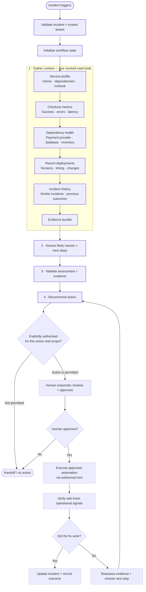

# PagerDuty SRE Agent — Session 1

A small, runnable **incident-response agent prototype** built with LangGraph, Pydantic and SQLite. It investigates a synthetic SEV-1 checkout incident, gathers evidence from mocked read tools, produces a structured assessment and stops before any state-changing action.

> **Offline by design:** incident data, tool integrations and model assessment are mocked. No PagerDuty account, API key or external service is required.

## Contents

1. [Interview brief coverage](#how-this-submission-maps-to-the-interview-brief)
2. [Context and objective](#1-context-and-objective)
3. [Synthetic incident scenario](#2-synthetic-incident-scenario)
4. [How the agent works](#3-how-the-agent-works)
5. [Run the prototype](#4-run-the-prototype)
6. [Implementation and repository map](#5-implementation-and-repository-map)
7. [Scope and production readiness](#6-scope-and-production-readiness)

## How this submission maps to the interview brief

The brief separates the discussion into **Session 1: designing the agent** and **Session 2: operating it in production**. This table makes the coverage explicit, including what the take-home does not attempt to implement.

### Session 1 — “In the box”

| Area from the brief | What this submission demonstrates | Coverage |
|---|---|---|
| **Core loop** | Incident intake → tenant validation → five context reads → evidence bundle → assessment → recommendation. | <strong>Implemented</strong> |
| **State** | Typed workflow state, SQLite snapshot and append-only event history for a local run. | <strong>Partial</strong> — no distributed recovery or long-running incident lifecycle |
| **Memory** | Synthetic incident history is queried as one of the context tools. | <strong>Limited</strong> — no curated cross-incident memory or learning |
| **Multiplayer** | Tenant context is validated before tool access. | <strong>Not implemented</strong> — no concurrent responders, agent coordination or shared-surface synchronization |
| **Actions and safety** | Typed proposed mitigation, evidence validation and a stop before execution. | <strong>Partial</strong> — approval workflow and action executor are not implemented |
| **Scale** | Identifies likely burst bottlenecks and production controls in the design discussion below. | <strong>Not implemented / not load-tested</strong> |
| **Extensibility** | Five local read tools illustrate a narrow integration boundary. | <strong>Limited</strong> — no real MCP transport, integration registry or multilingual support |

### Session 2 — “Around the box”

| Area from the brief | What this submission covers | Coverage |
|---|---|---|
| **Knowing it works** | Unit tests cover workflow and safety invariants; production evaluation proposes incident-trace datasets and responder review. | <strong>Partial</strong> — no model-quality evaluation; assessment is deterministic and mocked |
| **Shipping changes** | CI runs validation; production design describes versioning, shadow mode, canaries and rollback. | <strong>Partial</strong> — no deployed release pipeline or canary system |
| **Monitoring** | Production signals and degraded-mode behaviour are specified. | <strong>Design only</strong> — no production telemetry or alerting |
| **Cost and latency** | Budgets, quotas, retries and likely bottlenecks are identified. | <strong>Design only</strong> — no live model costs, latency measurements or load benchmarks |
| **Trust and governance** | Tenant validation, evidence provenance and local event history; production controls include authorization, audit and approval expiry. | <strong>Partial</strong> — no production identity, policy engine or approval service |
| **The recursive case** | Independent kill switch, read-only containment, trace preservation and regression follow-up are proposed. | <strong>Design only</strong> — no action executor exists to trigger this scenario |

**Reading the coverage accurately:** “Implemented” means present in this runnable prototype. “Partial” means a bounded slice is implemented and the remaining production capability is stated. “Design only” means an approach is described, not built or validated. This is a focused take-home, not a claim that all interview areas are production-ready.

## 1. Context and objective

PagerDuty's SRE Agent acts as a virtual responder: when an incident triggers, it gathers context from observability, on-call and service ownership data, and incident history. It suggests likely root causes and next actions. **Where an action has been explicitly authorised, it can also run the approved automation and verify whether the fix worked.**

The important distinction is that authorisation is not the same as a recommendation. The agent must never grant itself permission. For this exercise, any state-changing action requires explicit human approval, consistent with the brief's assumption of predefined actions that need approval and no autonomous actions. A broader production policy may support tightly scoped pre-authorized automations, but that is outside this prototype. Every executed action must be verified using fresh operational signals.

This take-home implements the investigation and recommendation slice. Its local demo deliberately has no write executor, so it stops before any state-changing action.

## 2. Synthetic incident scenario

At 03:00, checkout success drops while payment-provider timeouts, HTTP 5xx errors and latency rise. A recent deployment changed payment-provider timeout and retry behaviour.

| Signal | Baseline | Incident |
|---|---:|---:|
| Checkout success | 98.7% | **61.2%** |
| HTTP 5xx rate | 0.8% | **14.6%** |
| p95 latency | 420 ms | **3,200 ms** |
| Payment-provider timeout rate | 0.4% | **8.9%** |

**Candidate contributor:** `checkout-v2.8.1`, deployed 11 minutes before the incident.

**Proposed mitigation:** `rollback_deployment("checkout-v2.8.1")`.

This is a hypothesis, not a confirmed root cause. For this take-home, the proposed rollback would require explicit human approval before execution. Model confidence is never authorization.

> All incident IDs, metrics, services, deployments and historical records are fabricated for this exercise. The scenario is inspired by the engineering context of building an AI-enabled e-commerce platform at a stealth AI startup; it does not describe an actual outage.

## 3. How the agent works

The end-to-end lifecycle below includes both possible action paths. The first part—incident validation, context gathering, assessment, validation and recommendation—is implemented in this prototype. Authorization, execution and recovery verification are production design paths and are not implemented here.



**What each read tool provides:**
- **Service profile:** who owns the service, what it depends on and where its runbook is.
- **Checkout metrics:** whether checkout success, error rate and latency have changed.
- **Dependency health:** whether connected systems, such as the payment provider, database or inventory service, are degraded.
- **Recent deployments:** what changed recently and whether the timing correlates with the incident.
- **Incident history:** whether similar incidents happened before and what happened after previous mitigations.

The tools run sequentially in the order shown. Each successful read contributes evidence to the bundle; a failed read is recorded as a tool error, and the remaining reads continue. The prototype uses deterministic mock data for all five.

**How to read the boundary:**
- **Implemented in this take-home:** incident validation, five sequential mock reads, evidence bundle, deterministic assessment, output validation, recommendation and persistence.
- **Production flow:** deterministic authorization check, human approval when needed, execution through an authorized tool, and post-action verification.
- **Approval boundary:** for this exercise, every state-changing action requires explicit human approval; disallowed actions are handed off without execution.
- **Recovery is a feedback loop:** if fresh signals do not show recovery, the agent reassesses rather than declaring success.

The agent must not infer authorization from its own assessment. Policy enforcement belongs in deterministic controls and the destination system, not in model-generated text.

## 4. Run the prototype

Requirements: Python 3.11+

```bash
git clone https://github.com/rudolfo-felix/pager-duty.git
cd pager-duty
git checkout take-home-complete

python -m venv .venv
source .venv/bin/activate
pip install -r requirements.txt

python demo.py --reset
```

The demo prints the incident, gathered evidence, structured assessment and final safety status:

```text
AWAITING_HUMAN_DECISION
No write action executed.
```

Run the tests:

```bash
python -m unittest discover -s tests -v
```

The demo creates a local SQLite database at `runtime/agent.db`. Use `--reset` to start with a clean demo database.

## 5. Implementation and repository map

| Concern | Prototype implementation |
|---|---|
| Orchestration | LangGraph state graph |
| Contracts | Pydantic models for incident, evidence, assessment and proposed action |
| Context | Five deterministic, tenant-scoped, read-only mock tools |
| Assessment | Deterministic local `_mock_assessment`; no LLM API call |
| Persistence | SQLite snapshot + append-only incident event history |
| Safety boundary | Stops at `AWAITING_HUMAN_DECISION`; no write executor |

### Mocked read tools

`get_service_profile` · `get_checkout_metrics` · `get_dependency_health` · `get_recent_deployments` · `search_incident_history`

### Repository map

| File | Purpose |
|---|---|
| `agent.py` | Contracts, mock tools, graph, assessment and persistence |
| `demo.py` | Synthetic incident and runnable entry point |
| `tests/test_agent.py` | Tests for the core flow, tenant boundary, evidence and persistence |
| `requirements.txt` | Python dependencies |
| `.github/workflows/validate.yml` | CI: install, tests and demo |

**Suggested reading order:** run `demo.py` → inspect `Incident` and `Evidence` in `agent.py` → follow the graph nodes → read `tests/test_agent.py` → review the production-readiness checklist below.

## 6. Scope and production readiness

### Deliberately not implemented

- Real PagerDuty, MCP or observability integrations.
- A live LLM call or model-provider adapter.
- Authorization policy engine, approval UI, write executor or post-action verification.
- Cross-incident memory or multiplayer collaboration.
- Distributed workers, multi-region failover or load testing.

MCP is represented by local MCP-shaped functions; there is no MCP client/server or network transport. SQLite and in-process checkpointing make this a local prototype, not a distributed runtime.

### Production considerations

These are production design considerations, not implemented capabilities. They describe what would need to be added before operating the prototype as a production responder.

| Area | What production needs |
|---|---|
| **Evaluation** | Versioned incident traces; test grounding, evidence quality, tool failures, ambiguity and safe abstention. Combine automated regression metrics with responder review. |
| **Release safety** | Version models, prompts, graph, tools and policies together. Gate releases with unit, contract, security and offline evaluations; deploy through shadow mode and tenant canaries with fast rollback. |
| **Monitoring** | Track queue age, latency, throughput, tool/model errors, retries, cost, evidence freshness, approvals and action outcomes. Degrade or escalate when critical evidence is missing or stale. |
| **Resilience** | Bound time, tool/model calls, tokens and retries. Use backpressure, tenant-fair queues, circuit breakers, dependency bulkheads and severity-aware load shedding. |
| **Trust & tenancy** | Enforce tenant scope and authorization at every tool boundary. Audit decisions and tool I/O; expire approvals when incident state changes; enforce idempotency at the destination. |
| **Agent-caused incidents** | Keep an independent kill switch. Revoke pending approvals, force read-only mode, preserve traces, recover with a human and add the failure to regression tests. |
| **Regional outage / burst load** | Use durable queues, priority lanes, tenant quotas, bounded concurrency and retry budgets. Watch observability/MCP pools and model RPM/TPM limits. Burst capacity is not tested here. |

---

**Design principle:** the agent can recommend and, when explicitly authorized, invoke approved automations. It must never authorize itself. Tenant scope, tool allowlists, approvals and idempotency must be enforced deterministically and again by destination systems. A checkpoint does not make external side effects exactly-once.
