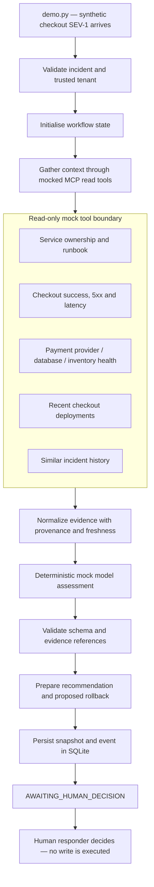

# PagerDuty SRE Agent — Session 1 prototype

A small, runnable Python sketch of the SRE Agent core loop. It uses **LangGraph** for explicit orchestration, Pydantic for typed contracts, mocked MCP-shaped read tools, a deterministic mock model, and SQLite for inspectable incident snapshots and event history.

## Overview

The demo follows one incident from intake to a human decision boundary:



The graph investigates and proposes; it does not autonomously change customer infrastructure.

## Case study: SEV-1 checkout reliability incident

**Scenario is synthetic and is not a claim about an actual production outage.** It is inspired by the engineering context of building an AI-enabled e-commerce platform at a stealth AI startup. The exercise focuses on a business-critical checkout path without disclosing company or product identifiers.

At 03:00, an on-call engineer receives a SEV-1 page. Customers are experiencing a sharp decline in successful purchases. Checkout requests are returning more server errors and taking longer to complete. The payment-provider dependency is timing out more frequently. A recent checkout deployment changed the payment-provider client's timeout and retry policy, making it a plausible contributor—but temporal correlation is not proof of root cause.

The demo creates synthetic incident `INC-2026-0042` for tenant `acme-prod` and service `checkout-api`.

### Mock evidence returned by the tools

| Evidence source | Synthetic observation |
|---|---|
| Service profile | Tier-1 checkout service, owned by Commerce Platform; dependencies include payment provider, orders database and inventory API |
| Checkout metrics | Success rate fell from 98.7% to 61.2%; HTTP 5xx rate rose from 0.8% to 14.6%; p95 latency rose from 420 ms to 3,200 ms; 18,420 requests in the sample window |
| Dependency health | Payment-provider timeout rate rose from 0.4% to 8.9% and p95 latency is 2,400 ms; orders database and inventory API are reported healthy |
| Recent deployments | `checkout-v2.8.1` was deployed 11 minutes earlier and changed payment-provider timeout/retry behaviour |
| Incident history | Synthetic prior incident `INC-2025-0187` reports a similar pattern after a retry-policy change; its recorded outcome was a configuration rollback |

All figures, identifiers, service names, deployment details and historical records above are fabricated for this exercise. They are not measurements or records from the user's current platform.

### Agent assessment and handoff

The deterministic mock model identifies the timeout/retry-policy change and degraded payment-provider responses as hypotheses. It preserves the distinction between correlation and confirmed cause, calls out missing checks (independent provider status, deployment-cohort comparison and possible provider rate limiting), and recommends involving the service owner.

It proposes `rollback_deployment(version="checkout-v2.8.1")` as a candidate mitigation. This is a **proposal only**: the graph has no write executor, does not roll back a deployment, and does not claim recovery. A human must validate blast radius and compatibility, explicitly authorize any change through a separate operational path, and verify recovery using fresh checkout-success and payment-latency signals.

## Selected design areas

The exercise asks us to choose one or two of the six Session 1 areas and demonstrate them in code. This submission focuses on **State** and **Actions and safety**.

| Session 1 area | Selection | Implementation / boundary |
|---|---|---|
| **State** | **Selected — demonstrated in code** | Typed LangGraph state carries the incident through explicit workflow nodes. SQLite stores a snapshot and append-only event history; the local graph uses an in-process checkpoint saver. |
| **Memory** | Out of scope | No curated long-term or cross-incident memory. Similar incident history is synthetic data returned by a mock tool. |
| **Multiplayer** | Out of scope | One responder / one surface; concurrent human-agent updates and conflict resolution are not implemented. |
| **Actions and safety** | **Selected — demonstrated in code** | The agent emits a typed proposed action and stops at `AWAITING_HUMAN_DECISION`. No write-action executor or approval UI exists. |
| **Scale** | Out of scope | No distributed workers, durable queue, multi-region failover, load testing or production concurrency controls. |
| **Extensibility** | Partial, not selected | Read tools have a small typed interface, but there is no real MCP transport, connector registry or dynamic capability discovery. |

Multi-tenant isolation is an additional baseline constraint, not one of the six selected areas. Trusted tenant context is supplied by the caller and checked before tool access.

## Mock everything external

The assignment explicitly permits mocking external dependencies. **The default demo is fully offline and deterministic.** No external credentials, network calls, third-party services or live model are used.

| Boundary | Mock used |
|---|---|
| Incident source / PagerDuty trigger | Synthetic Pydantic `Incident` created in `demo.py` |
| Service ownership and runbook | Local `get_service_profile` mock |
| Checkout observability | Local `get_checkout_metrics` mock with synthetic success, 5xx, latency and sample-count data |
| Dependency health | Local `get_dependency_health` mock for payment provider, orders DB and inventory API |
| Deployment platform | Local `get_recent_deployments` mock |
| Incident history | Local `search_incident_history` mock with synthetic historical record |
| MCP integration | Typed local Python functions shaped like read-tool calls; **no MCP server, client, protocol transport or network integration** |
| Model call | Deterministic `_mock_assessment` function returning a Pydantic `Assessment`; **no LLM API call or model credentials** |
| Persistence | Local SQLite database |

The five mock tools are read-only. Their responses include evidence identifiers, tenant scope, source, observation time, freshness and status. A tool failure is represented as an explicit error rather than invented evidence.

## Run locally

Python 3.11+ is recommended.

```bash
python -m venv .venv
source .venv/bin/activate
pip install -r requirements.txt
python demo.py --reset
python -m unittest discover -s tests -v
```

No API key or external service is needed.

## Main libraries

- `langgraph`: `StateGraph`, `START`, `END`, `MemorySaver` for graph orchestration and in-process checkpointing.
- `pydantic`: typed incident, evidence, proposed-action and assessment contracts.
- `sqlite3`: local durable snapshot and append-only event history.

## Assumptions from the exercise

- One responder, one surface, one agent.
- Third-party context is obtained through MCP tool calls; this prototype represents those calls with local mocks.
- Read-only tools are available. A small allowlisted write capability is represented as a proposed action, but execution is outside this core-loop demo.
- No autonomous actions.
- Multi-tenant SaaS: tenant context is injected by the trusted caller and checked before tool access.

## What is intentionally not implemented

Real PagerDuty event ingestion, real MCP transport/server, Slack/Teams/PagerDuty UI, real observability or payment-provider integrations, approval UI, write-action executor, multi-responder concurrency, distributed workers, multi-region failover, load testing, production secrets management and full post-action SLI verification. SQLite and in-memory LangGraph checkpointing are suitable for a local demonstration, not a multi-host production deployment.

## Where it breaks first

For a burst of correlated incidents, downstream observability/MCP rate limits and model-provider quotas would be likely bottlenecks in a live deployment; retries can amplify load. Production would require durable queue ingestion, tenant-fair priority scheduling, per-dependency concurrency limits, backpressure, deadlines, bounded retries with jitter, circuit breakers and explicit degraded responses. The current demo does not model or benchmark that load.

The assignment gives no numeric region-outage traffic profile. Any capacity multiplier must be labelled as a hypothetical assumption and validated with load tests.

## Design boundary

LangGraph owns orchestration and workflow state, not authorization. Tenant scope, tool allowlists, approval and idempotency must be enforced in deterministic code and, for real writes, again by the destination system. A checkpoint does not make an external side effect exactly-once. This implementation avoids that problem by not executing external writes.
