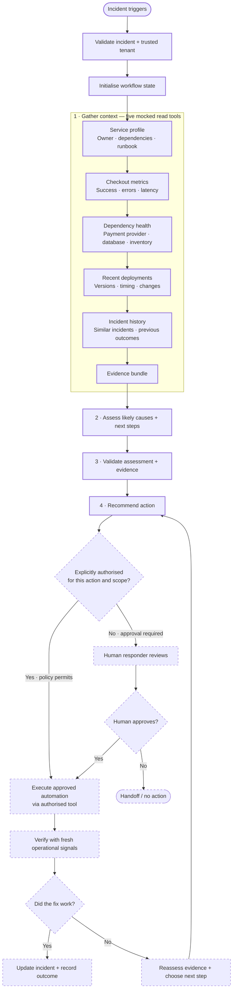

# PagerDuty SRE Agent — Session 1

A small, runnable **incident-response agent prototype** built with LangGraph, Pydantic and SQLite. It investigates a synthetic SEV-1 checkout incident, gathers evidence from mocked read tools, produces a structured assessment and stops before any state-changing action.

> **Offline by design:** incident data, tool integrations and model assessment are mocked. No PagerDuty account, API key or external service is required.

## Contents

1. [Context and objective](#1-context-and-objective)
2. [Synthetic incident scenario](#2-synthetic-incident-scenario)
3. [How the agent works](#3-how-the-agent-works)
4. [Run the prototype](#4-run-the-prototype)
5. [Implementation and repository map](#5-implementation-and-repository-map)
6. [Scope and production considerations](#6-scope-and-production-considerations)

## 1. Context and objective

PagerDuty's SRE Agent acts as a virtual responder: when an incident triggers, it gathers context from observability, on-call and service ownership data, and incident history. It suggests likely root causes and next actions. **Where an action has been explicitly authorised, it can also run the approved automation and verify whether the fix worked.**

The important distinction is that authorisation is not the same as a recommendation. The agent must never grant itself permission. A production system should evaluate an action against explicit policy and authorization context: some actions may be pre-approved within a defined scope; others require a human responder to approve them. Every executed action must be verified using fresh operational signals.

This take-home implements the investigation and recommendation slice. Its local demo deliberately has no write executor, so it stops before any state-changing action.

## 2. Synthetic incident scenario

At 03:00, checkout success drops while payment-provider timeouts, HTTP 5xx errors and latency rise. A recent deployment changed payment-provider timeout and retry behaviour.

| Signal | Baseline | Incident |
|---|---:|---:|
| Checkout success | 98.7% | **61.2%** |
| HTTP 5xx rate | 0.8% | **14.6%** |
| p95 latency | 420 ms | **3,200 ms** |
| Payment-provider timeout rate | 0.4% | **8.9%** |

**Candidate contributor:** `checkout-v2.8.1`, deployed 11 minutes before the incident.

**Proposed mitigation:** `rollback_deployment("checkout-v2.8.1")`.

This is a hypothesis, not a confirmed root cause. Whether a rollback can run automatically depends on explicit authorization, action scope and policy—not on the model's confidence or recommendation alone.

> All incident IDs, metrics, services, deployments and historical records are fabricated for this exercise. The scenario is inspired by the engineering context of building an AI-enabled e-commerce platform at a stealth AI startup; it does not describe an actual outage.

## 3. How the agent works

The end-to-end lifecycle below includes both possible action paths. The first part—incident validation, context gathering, assessment, validation and recommendation—is implemented in this prototype. Authorization, execution and recovery verification are production design paths and are not implemented here.



**What each read tool provides:**
- **Service profile:** who owns the service, what it depends on and where its runbook is.
- **Checkout metrics:** whether checkout success, error rate and latency have changed.
- **Dependency health:** whether connected systems, such as the payment provider, database or inventory service, are degraded.
- **Recent deployments:** what changed recently and whether the timing correlates with the incident.
- **Incident history:** whether similar incidents happened before and what happened after previous mitigations.

The tools run sequentially in the order shown. Each successful read contributes evidence to the bundle; a failed read is recorded as a tool error, and the remaining reads continue. The prototype uses deterministic mock data for all five.

**How to read the boundary:**
- **Implemented in this take-home:** incident validation, five sequential mock reads, evidence bundle, deterministic assessment, output validation, recommendation and persistence.
- **Production flow:** deterministic authorization check, human approval when needed, execution through an authorized tool, and post-action verification.
- **Two valid outcomes:** a pre-authorized action can proceed without a new human approval; an action outside that authorization scope must be reviewed or handed off.
- **Recovery is a feedback loop:** if fresh signals do not show recovery, the agent reassesses rather than declaring success.

The agent must not infer authorization from its own assessment. Policy enforcement belongs in deterministic controls and the destination system, not in model-generated text.

## 4. Run the prototype

Requirements: Python 3.11+

```bash
git clone https://github.com/rudolfo-felix/pager-duty.git
cd pager-duty
git checkout take-home-complete

python -m venv .venv
source .venv/bin/activate
pip install -r requirements.txt

python demo.py --reset
```

The demo prints the incident, gathered evidence, structured assessment and final safety status:

```text
AWAITING_HUMAN_DECISION
No write action executed.
```

Run the tests:

```bash
python -m unittest discover -s tests -v
```

The demo creates a local SQLite database at `runtime/agent.db`. Use `--reset` to start with a clean demo database.

## 5. Implementation and repository map

| Concern | Prototype implementation |
|---|---|
| Orchestration | LangGraph state graph |
| Contracts | Pydantic models for incident, evidence, assessment and proposed action |
| Context | Five deterministic, tenant-scoped, read-only mock tools |
| Assessment | Deterministic local `_mock_assessment`; no LLM API call |
| Persistence | SQLite snapshot + append-only incident event history |
| Safety boundary | Stops at `AWAITING_HUMAN_DECISION`; no write executor |

### Mocked read tools

`get_service_profile` · `get_checkout_metrics` · `get_dependency_health` · `get_recent_deployments` · `search_incident_history`

### Repository map

| File | Purpose |
|---|---|
| `agent.py` | Contracts, mock tools, graph, assessment and persistence |
| `demo.py` | Synthetic incident and runnable entry point |
| `tests/test_agent.py` | Tests for the core flow, tenant boundary, evidence and persistence |
| `requirements.txt` | Python dependencies |
| `.github/workflows/validate.yml` | CI: install, tests and demo |
| `PRODUCTION_DISCUSSION.md` | Session 2 design notes: evaluation, rollout, monitoring, failure and scale |

**Suggested reading order:** run `demo.py` → inspect `Incident` and `Evidence` in `agent.py` → follow the graph nodes → read `tests/test_agent.py` → review `PRODUCTION_DISCUSSION.md`.

## 6. Scope and production considerations

### Deliberately not implemented

- Real PagerDuty, MCP or observability integrations.
- A live LLM call or model-provider adapter.
- Authorization policy engine, approval UI, write executor or post-action verification.
- Cross-incident memory or multiplayer collaboration.
- Distributed workers, multi-region failover or load testing.

MCP is represented by local MCP-shaped functions; there is no MCP client/server or network transport. SQLite and in-process checkpointing make this a local prototype, not a distributed runtime.

### Where this would need to grow

A production system would need durable queueing, tenant-fair scheduling, bounded concurrency and retries, backpressure, deadlines, circuit breakers, explicit degraded responses and independently enforced authorization. The action layer should enforce allowlists, resource/tenant scope, approval expiry, idempotency and audit trails. It should verify outcomes using fresh telemetry and loop back into investigation when recovery is not demonstrated.

The likely early bottlenecks during correlated incident bursts are downstream observability/tool limits and model-provider quotas. This prototype does not benchmark burst capacity.

For the broader Session 2 discussion, see [PRODUCTION_DISCUSSION.md](PRODUCTION_DISCUSSION.md).

---

**Design principle:** the agent can recommend and, when explicitly authorized, invoke approved automations. It must never authorize itself. Tenant scope, tool allowlists, approvals and idempotency must be enforced deterministically and again by destination systems. A checkpoint does not make external side effects exactly-once.
