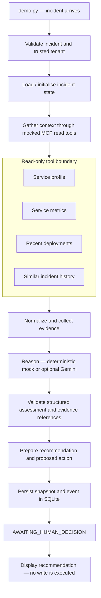

# PagerDuty SRE Agent — Session 1 prototype

A small, runnable Python sketch of the SRE Agent's core loop. It uses **LangGraph** for explicit orchestration, Pydantic for typed contracts, mocked MCP-shaped read tools, and SQLite for inspectable incident snapshots and event history.

## Overview

The demo follows one incident from intake to a human decision boundary:



The graph is deliberately bounded: it investigates and proposes; it does not autonomously change customer infrastructure.

## Selected design areas

The exercise asks us to choose one or two of the six Session 1 areas and demonstrate them in code. This submission deliberately focuses on **State** and **Actions and safety**.

| Session 1 area | Selection | How this prototype handles it |
|---|---|---|
| **State** | **Selected — demonstrated in code** | A typed LangGraph state carries the incident through explicit workflow nodes. SQLite stores an incident snapshot and append-only event history. The local graph also uses LangGraph's in-process checkpoint saver. |
| **Memory** | Out of scope | No curated long-term or cross-incident memory is implemented. Similar incident history is returned by a mocked read tool for this scenario; it is not a memory-learning system. |
| **Multiplayer** | Out of scope | The exercise assumption is one responder on one surface. Concurrent human/agent updates and conflict resolution are not implemented. |
| **Actions and safety** | **Selected — demonstrated in code** | The agent can propose a typed action, but the workflow stops at `AWAITING_HUMAN_DECISION`. There is no write-action executor, so the model cannot perform a rollback. |
| **Scale** | Out of scope | No distributed workers, durable queue, multi-region failover, load testing or production concurrency controls are implemented. |
| **Extensibility** | Partial, not a selected area | Tool functions are separated behind a small interface-like boundary, but there is no real MCP transport, connector registry or dynamic capability discovery. |

Multi-tenant isolation is an additional baseline constraint from the exercise, not one of the six selected areas. The trusted caller supplies tenant context, and the implementation checks it before tool access.

## What it demonstrates

1. Validate incident identity and trusted tenant context.
2. Gather service ownership/runbook context, focused metrics, recent deployments, and verified incident history through four mocked read tools.
3. Preserve evidence provenance, timestamps, freshness and retrieval status.
4. Produce a structured assessment with hypotheses, supporting evidence, missing information, recommendation and a proposed next action.
5. Validate that the model only refers to evidence actually retrieved.
6. Persist the outcome and stop at a human decision boundary. **No write action is executed.**

## Run locally

Python 3.11+ is recommended.

```bash
python -m venv .venv
source .venv/bin/activate
pip install -r requirements.txt
python demo.py --reset
python -m unittest discover -s tests -v
```

No API key or external service is needed. The deterministic mock model is the default.

### Optional Gemini model

To use a live Gemini model for structured assessment:

```bash
export GOOGLE_API_KEY="..."
export USE_LIVE_MODEL=1
export GEMINI_MODEL="gemini-2.5-flash"
python demo.py --reset
```

The live model is still not allowed to execute tools or authorize writes. Its output must pass Pydantic validation and evidence-reference validation.

## Main libraries and imports

- `langgraph`: `StateGraph`, `START`, `END`, `MemorySaver` for explicit graph orchestration and checkpointing within the process.
- `pydantic`: typed incident, evidence and assessment contracts.
- `sqlite3`: local durable snapshot and append-only event history.
- `langchain-google-genai` (optional): Gemini structured-output adapter.

## Mock incident

`INC-2026-0042` — SEV-1 on `payments-api`, elevated 503s and p95 latency after deployment `v1.4.2`. Mock evidence includes a tier-1 service profile, service metrics, recent deployment and a verified similar incident.

The mock assessment identifies the deployment as a plausible cause, lists missing checks, recommends human review, and proposes `rollback_deployment(v1.4.2)` as a candidate action. This is a proposal only.

## Assumptions from the exercise

- One responder, one surface, one agent.
- Third-party data is accessed only through MCP tool calls (represented here by local MCP-shaped mock functions).
- Read-only tools are available. A small allowlisted write capability is represented as a proposed action, but execution is deliberately outside this core-loop demo.
- No autonomous actions.
- Multi-tenant SaaS: tenant context is injected by the trusted caller and checked before tool access.

## What is intentionally not implemented

Real MCP transport/server, Slack/Teams/PagerDuty UI, real observability integrations, approval UI, write-action executor, multi-responder concurrency, distributed workers, multi-region failover, load testing, production secrets management and full post-action SLI verification. SQLite and in-memory LangGraph checkpointing are suitable for a local demonstration, not a multi-host production deployment.

## Where it breaks first

For a burst of correlated incidents, downstream observability/MCP rate limits and model-provider RPM/TPM quotas are likely bottlenecks; retries can amplify load. Production would require durable queue ingestion, tenant-fair priority scheduling, per-dependency concurrency limits, backpressure, deadlines, bounded retries with jitter, circuit breakers and explicit degraded responses.

The assignment gives no numeric region-outage traffic profile. Any capacity multiplier must be labelled as a hypothetical assumption and validated with load tests.

## Design boundary

LangGraph owns orchestration and workflow state, not authorization. Tenant scope, tool allowlists, approval and idempotency must be enforced in deterministic code and, for real writes, again by the destination system. A checkpoint does not make an external side effect exactly-once. The current implementation avoids that problem by not executing external writes.
