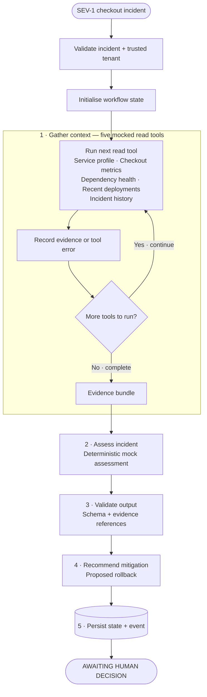

# PagerDuty SRE Agent — Session 1

A small, runnable **incident-response agent prototype** built with LangGraph, Pydantic and SQLite. It investigates a synthetic SEV-1 checkout incident, gathers evidence from mocked read tools, produces a structured assessment and stops before any state-changing action.

> **Offline by design:** incident data, tool integrations and model assessment are mocked. No PagerDuty account, API key or external service is required.

## 1. Start here

### Run the prototype

Requirements: Python 3.11+

```bash
git clone https://github.com/rudolfo-felix/pager-duty.git
cd pager-duty
git checkout take-home-complete

python -m venv .venv
source .venv/bin/activate
pip install -r requirements.txt

python demo.py --reset
```

The demo prints the incident, gathered evidence, structured assessment and final safety status:

```text
AWAITING_HUMAN_DECISION
No write action executed.
```

Run the tests:

```bash
python -m unittest discover -s tests -v
```

The demo creates a local SQLite database at `runtime/agent.db`. Use `--reset` to start with a clean demo database.

## 2. What happens in the scenario?

At 03:00, checkout success drops while payment-provider timeouts, HTTP 5xx errors and latency rise. A recent deployment changed payment-provider timeout and retry behaviour.

| Signal | Baseline | Incident |
|---|---:|---:|
| Checkout success | 98.7% | **61.2%** |
| HTTP 5xx rate | 0.8% | **14.6%** |
| p95 latency | 420 ms | **3,200 ms** |
| Payment-provider timeout rate | 0.4% | **8.9%** |

**Candidate contributor:** `checkout-v2.8.1`, deployed 11 minutes before the incident.

**Proposed mitigation:** `rollback_deployment("checkout-v2.8.1")`.

This is a hypothesis, not a confirmed root cause. The agent proposes a mitigation but does not execute it. A human responder must review the evidence, validate blast radius and compatibility, and authorize any change. Recovery must then be checked against fresh signals.

> All incident IDs, metrics, services, deployments and historical records are fabricated for this exercise. The scenario is inspired by the engineering context of building an AI-enabled e-commerce platform at a stealth AI startup; it does not describe an actual outage.

## 3. How the agent works

Follow the solid path from top to bottom. It shows the implemented prototype, from incident intake to the human-decision boundary.



**What this means:** the graph validates the incident and trusted tenant, runs the five reads sequentially, builds an evidence bundle, creates and validates an assessment, persists the result, then stops. A failed read is recorded and does not become fabricated evidence.

### After the human decision · production extension

This second flow is an intended production feedback loop, **not implemented in this take-home**.


The key boundary is deliberate: **the agent can recommend; it cannot authorize or execute a rollback.** A proposed action is not proof of recovery.

## 4. Implementation at a glance

| Concern | Prototype implementation |
|---|---|
| Orchestration | LangGraph state graph |
| Contracts | Pydantic models for incident, evidence, assessment and proposed action |
| Context | Five deterministic, tenant-scoped, read-only mock tools |
| Assessment | Deterministic local `_mock_assessment`; no LLM API call |
| Persistence | SQLite snapshot + append-only incident event history |
| Safety boundary | Stops at `AWAITING_HUMAN_DECISION`; no write executor |

### Mocked read tools

`get_service_profile` · `get_checkout_metrics` · `get_dependency_health` · `get_recent_deployments` · `search_incident_history`

### Repository map

| File | Purpose |
|---|---|
| `agent.py` | Contracts, mock tools, graph, assessment and persistence |
| `demo.py` | Synthetic incident and runnable entry point |
| `tests/test_agent.py` | Tests for the core flow, tenant boundary, evidence and persistence |
| `requirements.txt` | Python dependencies |
| `.github/workflows/validate.yml` | CI: install, tests and demo |
| `PRODUCTION_DISCUSSION.md` | Session 2 design notes: evaluation, rollout, monitoring, failure and scale |

**Suggested reading order:** run `demo.py` → inspect `Incident` and `Evidence` in `agent.py` → follow the graph nodes → read `tests/test_agent.py` → review `PRODUCTION_DISCUSSION.md`.

## 5. Scope and production considerations

### Deliberately not implemented

- Real PagerDuty, MCP or observability integrations.
- A live LLM call or model-provider adapter.
- Approval UI, write executor or post-action verification.
- Cross-incident memory or multiplayer collaboration.
- Distributed workers, multi-region failover or load testing.

MCP is represented by local MCP-shaped functions; there is no MCP client/server or network transport. SQLite and in-process checkpointing make this a local prototype, not a distributed runtime.

### Where this would need to grow

A production system would need durable queueing, tenant-fair scheduling, bounded concurrency and retries, backpressure, deadlines, circuit breakers, explicit degraded responses and independently enforced authorization. It would also need trace-based evaluation, staged rollout and operational monitoring.

The likely early bottlenecks during correlated incident bursts are downstream observability/tool limits and model-provider quotas. This prototype does not benchmark burst capacity.

For the broader Session 2 discussion, see [PRODUCTION_DISCUSSION.md](PRODUCTION_DISCUSSION.md).

---

**Design principle:** LangGraph orchestrates; it does not authorize. Tenant scope, tool allowlists, approvals and idempotency must be enforced deterministically and again by destination systems. A checkpoint does not make external side effects exactly-once.
