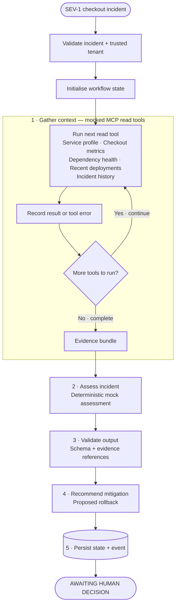
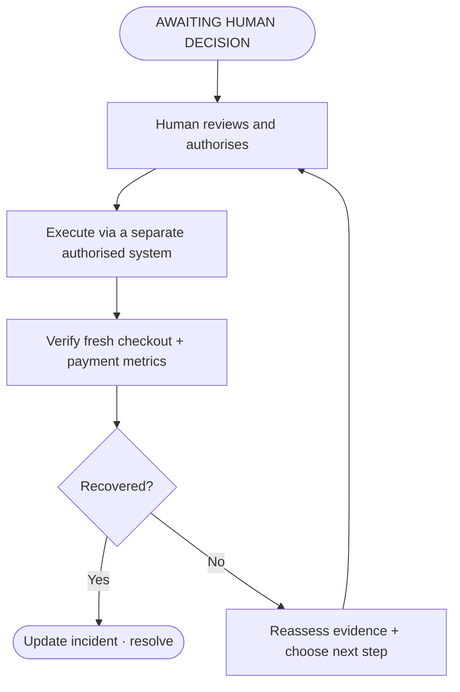

# PagerDuty SRE Agent — Session 1

A runnable, offline prototype of an incident-response agent using **LangGraph**, **Pydantic** and **SQLite**.

## Incident flow

Read this flow from top to bottom. The main path shows what the prototype implements; the production-only recovery process is shown separately below.



**The implemented path ends at human decision.** Tool calls run sequentially. Each read produces evidence or a recorded tool error; the workflow then continues to the next configured read.

### After the human decision · production extension

This is the intended operational feedback loop, **not implemented in this prototype**.



## Synthetic case study · checkout SEV-1

At 03:00, checkout success drops and payment-provider timeouts rise. A recent deployment changed timeout/retry behaviour. The agent gathers evidence, forms hypotheses and proposes a mitigation for a human responder.

| Signal | Baseline | Incident |
|---|---:|---:|
| Checkout success | 98.7% | **61.2%** |
| HTTP 5xx rate | 0.8% | **14.6%** |
| p95 latency | 420 ms | **3,200 ms** |
| Payment-provider timeout rate | 0.4% | **8.9%** |

**Candidate contributor:** `checkout-v2.8.1`, deployed 11 minutes before the incident, changed payment-provider timeout and retry behaviour.

**Proposed mitigation:** `rollback_deployment("checkout-v2.8.1")`.

The deployment is a hypothesis, not a confirmed root cause. The agent does not execute the rollback or claim recovery. A human must validate blast radius and compatibility, authorize any change, then verify recovery using fresh signals.

> All incident IDs, metrics, services, deployments and historical records are fabricated for this exercise. The scenario is inspired by the engineering context of building an AI-enabled e-commerce platform at a stealth AI startup; it does not describe an actual outage.

## What is implemented

| Area | Implementation |
|---|---|
| **State** | Typed LangGraph state; SQLite snapshot + append-only event history; in-process checkpointing |
| **Actions & safety** | Typed proposed action; stops at `AWAITING_HUMAN_DECISION`; no write executor |
| **Tenant boundary** | Trusted tenant context checked before mock tool access |
| **Evidence** | Five read tools; evidence IDs, source, tenant, timestamp, freshness and status |

### Five mocked read tools

`get_service_profile` · `get_checkout_metrics` · `get_dependency_health` · `get_recent_deployments` · `search_incident_history`

## Everything external is mocked

| Boundary | Local substitute |
|---|---|
| PagerDuty trigger | Synthetic Pydantic `Incident` in `demo.py` |
| Service, metrics, dependencies, deployments, history | Five deterministic Python mock functions |
| MCP | MCP-shaped local functions; **no MCP server/client or network transport** |
| Model | Deterministic `_mock_assessment`; **no LLM API call** |
| Persistence | Local SQLite |

The default run needs no API key, network access or external service.

## Run

Python 3.11+:

```bash
python -m venv .venv
source .venv/bin/activate
pip install -r requirements.txt
python demo.py --reset
python -m unittest discover -s tests -v
```

## Scope

**Selected:** State; Actions and safety.

**Not implemented:** real PagerDuty/MCP/observability integrations, approval UI, write executor, post-action verification, cross-incident memory, multiplayer, distributed workers, multi-region failover or load testing. Extensibility is limited to the small local tool boundary.

**First likely production bottlenecks:** observability/MCP rate limits and model-provider quotas during correlated incident bursts. A production design would add durable queueing, tenant-fair scheduling, bounded concurrency/retries, backpressure, deadlines and circuit breakers. This prototype does not benchmark burst capacity.

**Design boundary:** LangGraph orchestrates; it does not authorize. Tenant scope, tool allowlists, approvals and idempotency must be enforced deterministically and again by destination systems. A checkpoint does not make external side effects exactly-once.
